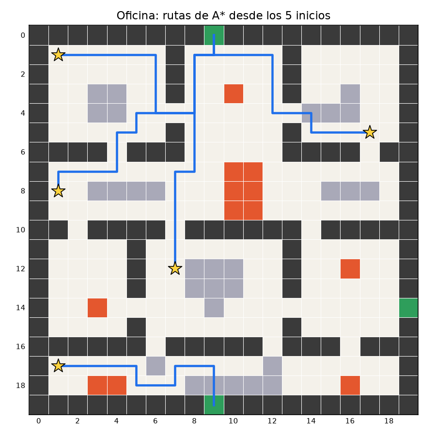
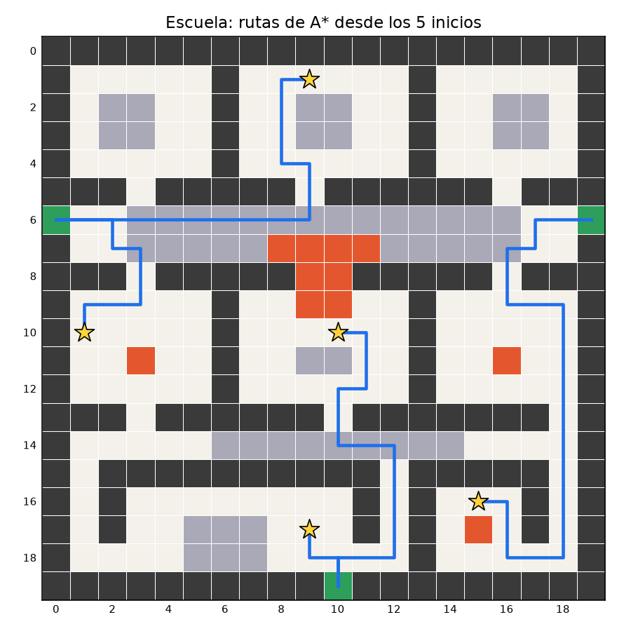
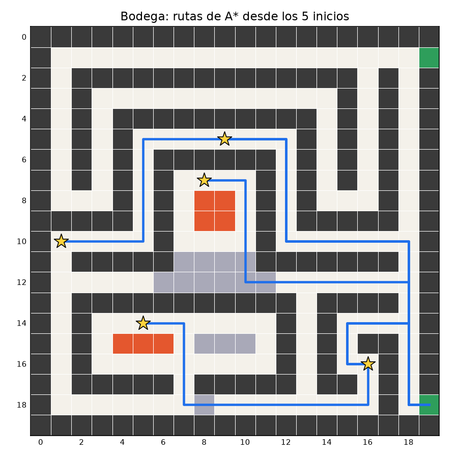
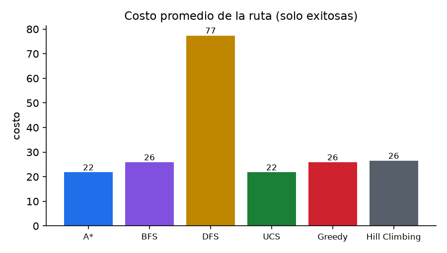
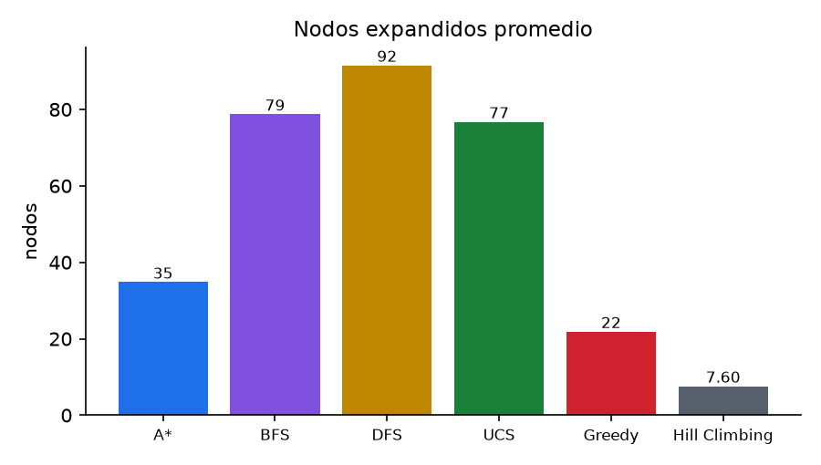
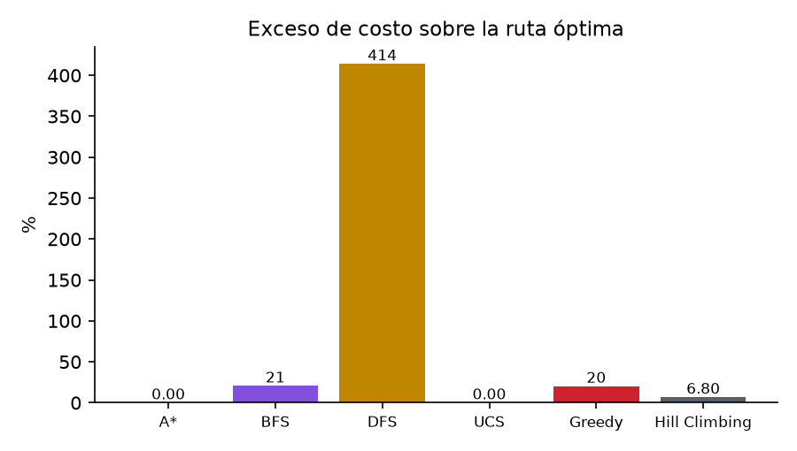
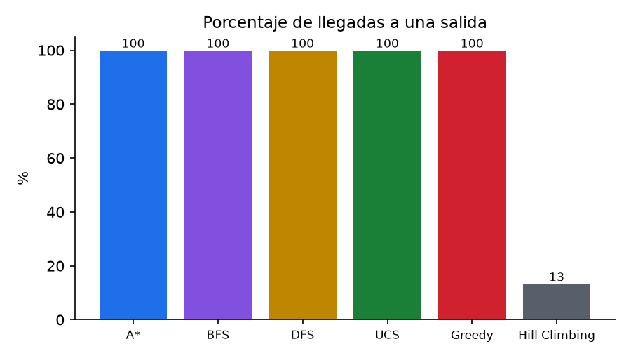
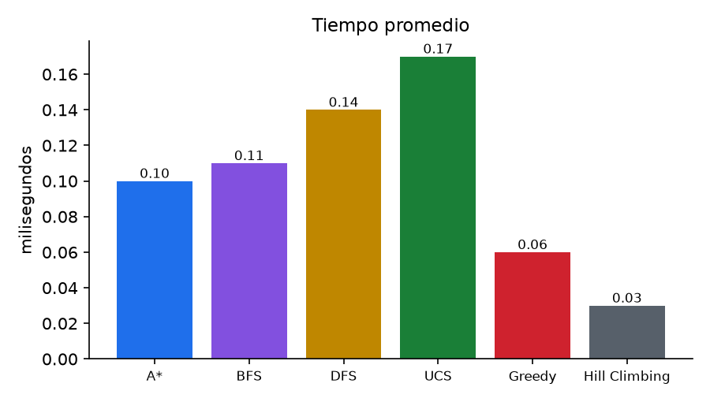
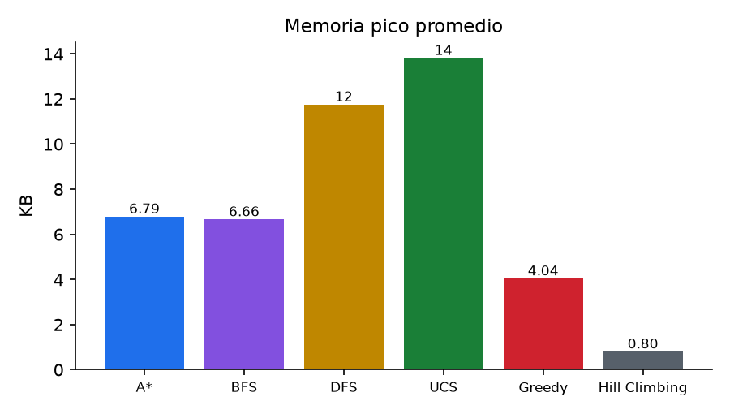

# Manual técnico: Simulador de escape de incendios

**Proyecto #33**: comparación de 6 algoritmos de búsqueda para la evacuación de un edificio

| Parte | Responsable |
|---|---|
| 1. Mapas, representación de la cuadrícula y estructura | ____ |
| 2. BFS, DFS y UCS | ____ |
| 3. Greedy, A* y Hill Climbing | ____ |
| 4. Métricas, gráficas e interfaz | ____ |

Fecha de entrega: ____ *(pendiente de confirmar con la profesora)*

> **Borrador.** Cada integrante revisa y completa la sección de su parte. Los números de la
> sección 8 salen de `resultados/resumen.csv`; si se cambian los mapas hay que volver a correr
> `experimentos.py` y actualizarlos. Los tiempos cambian un poco en cada computadora.

---

## 1. Objetivo

Comparar y explicar 6 algoritmos de búsqueda (BFS, DFS, UCS, Greedy Best-First, A* y Hill
Climbing) que buscan la ruta de evacuación de un edificio con humo, fuego y varias salidas.
A* es el algoritmo principal. La comparación mide qué algoritmo llega con **menor costo** y
con **menos cálculo**.

## 2. Instalación

Requisitos: Python 3.10 o más reciente (se probó con 3.14 en Windows 11).

```bash
python -m venv .venv
.venv\Scripts\python -m pip install -r requirements.txt
```

| Comando | Qué hace |
|---|---|
| `.venv\Scripts\python -m streamlit run app.py` | Abre la interfaz en el navegador (`http://localhost:8501`) |
| `.venv\Scripts\python experimentos.py` | Corre las 90 pruebas y guarda la tabla y las gráficas en `resultados/` |
| `.venv\Scripts\python -m pytest -v` | Corre las 135 pruebas automáticas |

Dependencias: `streamlit` (interfaz), `matplotlib` y `numpy` (dibujo), `pandas` (tablas) y
`pytest` (pruebas). **Ninguna se usa para buscar rutas.** Los algoritmos solo usan la
biblioteca estándar: `collections.deque` (cola), `list` (pila) y `heapq` (cola de prioridad).

## 3. Arquitectura

```
app.py  ──────────────┐                ┌── experimentos.py
 (interfaz Streamlit) │                │   (corridas por lotes)
                      ▼                ▼
               simulador/metricas.py  ── mide tiempo y memoria
               simulador/memoria.py   ── memoización de rutas
               simulador/visual.py    ── dibujo del mapa y gráficas
                      │
                      ▼
               simulador/algoritmos/
                 base.py           Resultado común, reconstruir_ruta()
                 no_informados.py  bfs(), dfs(), ucs()
                 informados.py     greedy(), a_estrella(), hill_climbing()
                      │
                      ▼
               simulador/cuadricula.py  Cuadricula: vecinos, costo, heurística
               simulador/mapas.py       3 mapas + 5 inicios cada uno
```

Todos los algoritmos tienen la misma firma, `funcion(mapa, inicio) -> Resultado`, y están
registrados en el diccionario `ALGORITMOS`. Así la interfaz, las métricas y las pruebas los
tratan igual, y agregar un séptimo algoritmo solo requiere añadirlo a ese diccionario.

`Resultado` guarda: `exito`, `ruta`, `costo`, `pasos`, `nodos_expandidos`,
`nodos_generados`, `max_frontera`, `orden_expansion` (para dibujar lo explorado) y un
`mensaje`.

## 4. Modelo del problema

| Elemento | Definición |
|---|---|
| Estado | Posición `(fila, columna)` de la persona en la cuadrícula de 20 × 20 |
| Estado inicial | Uno de los 5 puntos de inicio de cada mapa (o uno elegido en la interfaz) |
| Acciones | Moverse arriba, abajo, izquierda o derecha (en ese orden) |
| Restricciones | No se puede entrar a muros (`#`) ni a fuego (`F`); el fuego no se mueve |
| Costo de un paso | Costo de la celda a la que se **entra**: libre o salida = 1, humo = 5 |
| Prueba de objetivo | La celda es una salida (`S`); sirve **cualquier** salida |
| Heurística h(n) | Distancia Manhattan a la salida más cercana |

### 4.1 ¿Por qué la heurística es admisible y consistente?

- **Admisible:** para llegar a una salida hacen falta al menos |Δfila| + |Δcolumna| pasos, y
  cada paso cuesta **como mínimo 1**. Por eso h(n) nunca supera el costo real. El humo solo
  encarece la ruta, así que h sigue siendo una estimación optimista.
- **Consistente:** al dar un paso, la distancia Manhattan a cualquier salida cambia en a lo
  más 1, y ese paso cuesta ≥ 1. Entonces h(n) ≤ c(n, n') + h(n').
- La prueba `test_heuristica_es_admisible` lo comprueba en **todas** las celdas libres de
  los 3 mapas, comparando h(n) con el costo óptimo que calcula UCS.

### 4.2 Los 3 mapas

| Mapa | Salidas | Qué pone a prueba |
|---|---|---|
| Oficina | 3 | Cuartos con puertas: es el caso "normal" |
| Escuela | 3 | Un pasillo central lleno de humo: ir derecho da menos pasos, pero cuesta más |
| Bodega | 2 | Pasillos en espiral y callejones: la salida parece cerca, pero hay que rodear |





## 5. Algoritmos

Reglas comunes para que la comparación sea justa:

1. La prueba de objetivo se hace al **expandir** (sacar de la frontera), no al generar.
2. Los vecinos siempre se generan en el orden arriba, abajo, izquierda y derecha.
3. Los empates en la cola de prioridad se rompen por orden de llegada (contador FIFO).
4. Todos, excepto Hill Climbing, son búsqueda en **grafo**: no repiten celdas ya expandidas.

Notación: V = celdas transitables (≤ 400), b = 4 (factor de ramificación).

### 5.1 BFS: búsqueda en amplitud *(parte 2)*

- **Estructura:** cola FIFO (`deque`).
- **Idea:** explora por capas: primero todo lo que está a 1 paso, luego a 2, etc.
- **Garantía:** encuentra la ruta con **menos pasos**, pero ignora el costo del humo.
- **Completo:** sí. **Óptimo en costo:** no (solo si todos los pasos costaran igual).
- **Complejidad:** tiempo y memoria O(V).

### 5.2 DFS: búsqueda en profundidad *(parte 2)*

- **Estructura:** pila LIFO (`list`).
- **Idea:** sigue un camino hasta el fondo antes de probar otro.
- **Completo:** sí, en grafos finitos con control de visitados. **Óptimo:** no.
- **Comportamiento:** la primera salida que encuentra depende del orden de los vecinos, y la
  ruta suele ser larga y serpenteante.

### 5.3 UCS: búsqueda de costo uniforme *(parte 2)*

- **Estructura:** cola de prioridad (`heapq`) ordenada por g(n), el costo acumulado.
- **Idea:** siempre expande lo más barato. Es Dijkstra con parada temprana en la primera salida.
- **Completo:** sí. **Óptimo en costo:** sí, porque todos los costos son positivos.
- **Complejidad:** O(V log V).

### 5.4 Greedy Best-First *(parte 3)*

- **Estructura:** cola de prioridad ordenada **solo por h(n)**.
- **Idea:** va hacia lo que "parece" más cerca de una salida, sin mirar lo que ya costó.
- **Completo:** sí (búsqueda en grafo finita). **Óptimo:** no; puede cruzar humo o meterse en
  un callejón.

### 5.5 A\*: algoritmo principal *(parte 3)*

- **Estructura:** cola de prioridad ordenada por **f(n) = g(n) + h(n)**. En empate de f se
  prefiere la menor h.
- **Idea:** combina lo que ya costó (como UCS) con una estimación de lo que falta (como
  Greedy).
- **Completo:** sí. **Óptimo:** sí, porque h es admisible y consistente (sección 4.1).
- **Por qué expande menos que UCS:** UCS expande todas las celdas con g < C\* (C\* = costo
  óptimo), en todas direcciones. A* solo expande las que tienen g + h < C\*, así que h
  descarta las celdas que se alejan de las salidas.

### 5.6 Hill Climbing *(parte 3)*

- **Variante:** máxima pendiente (*steepest ascent*). Como se minimiza la distancia,
  "subir" significa bajar h.
- **Idea:** desde la celda actual mira a sus vecinos y se mueve al de menor h, **solo si
  mejora estrictamente**. Si ningún vecino mejora, se detiene.
- **Memoria:** no guarda frontera ni visitados (frontera máxima = 1).
- **Completo:** no. **Óptimo:** no.
- **Falla típica:** un **mínimo local**, por ejemplo pegado a un muro detrás del cual está la
  salida. Para salir habría que alejarse de la salida, y el algoritmo nunca acepta empeorar.

### 5.7 Resumen teórico

| Algoritmo | Usa costo g | Usa heurística h | Completo | Óptimo en costo |
|---|---|---|---|---|
| BFS | no | no | sí | no (sí en pasos) |
| DFS | no | no | sí | no |
| UCS | sí | no | sí | sí |
| Greedy | no | sí | sí | no |
| A* | sí | sí | sí | **sí** |
| Hill Climbing | no | sí | **no** | no |

## 6. Métricas y metodología *(parte 4)*

| Métrica | Cómo se mide |
|---|---|
| Costo | Suma de los costos de las celdas de la ruta (sin contar el inicio) |
| Pasos | Número de movimientos (largo de la ruta − 1) |
| Nodos expandidos | Celdas que se sacaron de la frontera y se examinaron |
| Nodos generados | Celdas que se metieron a la frontera |
| Frontera máxima | Tamaño máximo de la frontera (memoria "lógica") |
| Tiempo | Mediana de 7 ejecuciones con `time.perf_counter()` |
| Memoria | Pico de memoria reservada con `tracemalloc` (en una corrida aparte) |
| Éxito | ¿Llegó a una salida? |
| Exceso de costo | (costo − costo óptimo de UCS) / costo óptimo × 100 % |

**Diseño del experimento:** 3 mapas × 5 inicios × 6 algoritmos = **90 corridas**.
El tiempo y la memoria se miden por separado porque `tracemalloc` hace más lento el código.

## 7. Pruebas

`tests/test_simulador.py` tiene **135 pruebas** y todas pasan:

| Grupo | Qué verifica |
|---|---|
| Mapas | Son 20 × 20, tienen salidas y los 5 inicios son celdas válidas |
| Cuadrícula | Costos, orden de los vecinos, heurística y rechazo de mapas mal formados |
| Rutas válidas (90 casos) | Cada movimiento es de 1 celda, no pisa muro ni fuego, el costo es correcto y termina en una salida |
| A* óptimo (15 casos) | A* tiene el mismo costo que UCS, expande ≤ nodos y ningún otro algoritmo es más barato |
| BFS (15 casos) | BFS da la ruta con menos pasos |
| Heurística | h(n) ≤ costo óptimo en todas las celdas de los 3 mapas |
| Humo | En un mapa pequeño, BFS cruza el humo (costo 17) y A*/UCS lo rodean (costo 9) |
| Hill Climbing | Se atora en un mínimo local donde A* sí encuentra salida |
| Casos límite | Sin salida alcanzable; inicio sobre un muro |
| Memoización | Recuerda, aprende sub-rutas óptimas, se invalida si cambia el mapa y persiste en disco |

## 8. Resultados

Promedios de las 90 corridas (`resultados/resumen.csv`). El costo y los pasos solo cuentan
las corridas exitosas.

| Algoritmo | Éxito | Costo prom. | Pasos prom. | Exceso de costo | Rutas óptimas | Expandidos prom. | Frontera máx. | Tiempo (ms) | Memoria (KB) |
|---|---|---|---|---|---|---|---|---|---|
| **A\*** | 100 % | **21.8** | 17.0 | **0 %** | **15/15** | 34.8 | 10.2 | 0.10 | 6.8 |
| BFS | 100 % | 25.9 | **15.7** | 20.6 % | 5/15 | 78.7 | 11.5 | 0.11 | 6.7 |
| DFS | 100 % | 77.4 | 49.7 | 414.1 % | 0/15 | 91.5 | 28.6 | 0.14 | 11.8 |
| UCS | 100 % | **21.8** | 17.0 | **0 %** | **15/15** | 76.7 | 11.7 | 0.17 | 13.8 |
| Greedy | 100 % | 25.9 | 17.9 | 20.2 % | 5/15 | 21.9 | 10.7 | 0.06 | 4.0 |
| Hill Climbing | 13.3 % | 26.5* | 8.5* | 6.8 %* | 1/15 | 7.6 | 1.0 | 0.03 | 0.8 |

\* Solo 2 de 15 corridas de Hill Climbing llegaron a una salida.








### 8.1 Análisis

- **A\* gana la comparación:** llega con el costo mínimo en los 15 casos y expande en
  promedio **55 % menos nodos que UCS** (34.8 contra 76.7), con la mitad de memoria. Esto
  confirma la teoría: con una heurística admisible y consistente, A* es óptimo y la
  heurística ahorra trabajo.
- **UCS** también es óptimo, pero explora "en círculo" alrededor del inicio porque no sabe
  dónde están las salidas.
- **BFS** da las rutas con **menos pasos** (15.7), pero un **20.6 % más caras**, porque cruza el
  humo cuando eso acorta el camino. Ejemplo: en Escuela desde (1, 9), BFS llega en 14 pasos con
  costo 50, mientras que A* da 16 pasos con costo 44.
- **Greedy** es el que menos calcula entre los completos (21.9 nodos), pero solo acierta la
  ruta óptima en 5 de 15 casos. Es rápido, pero no confiable.
- **DFS** es el peor en costo (más de 5 veces el óptimo) y en frontera máxima: sus rutas
  serpentean por todo el edificio.
- **Hill Climbing** usa casi nada de memoria, pero se atora en 13 de 15 casos. En un edificio
  con muros, acercarse en línea recta a la salida casi siempre termina contra una pared.
- **Tiempo:** todos tardan menos de 0.2 ms en un mapa de 400 celdas. Con este tamaño, la
  diferencia real está en los nodos expandidos, que no dependen de la computadora.

**Conclusión:** para evacuar, donde importa la ruta de menor costo (menos exposición al humo)
y que el cálculo sea poco, **A\*** es la mejor opción.

## 9. ¿Cuándo el sistema razona y cuándo aprende?

| | Razona | Aprende / recuerda |
|---|---|---|
| Cuándo | No tiene la respuesta guardada | Ya resolvió ese mapa, inicio y algoritmo (o una ruta que pasa por ese inicio) |
| Qué hace | Ejecuta el algoritmo de búsqueda y explora celdas | Busca la respuesta en la memoria (`simulador/memoria.py`) |
| Costo | Nodos expandidos > 0 | 0 nodos expandidos |

**Cómo funciona la memoización:**

1. La clave es `huella_del_mapa | algoritmo | inicio`. La huella es un hash del contenido del
   mapa: si se cambia una sola celda, las rutas viejas ya no aplican y el sistema vuelve a
   razonar.
2. **Sub-rutas (principio de optimalidad):** si la ruta óptima de A a la salida pasa por B,
   el tramo B → salida también es óptimo para B. Por eso, al resolver con A* o UCS, también
   se guardan las rutas de **todas** las celdas intermedias. Esto no se hace con BFS, DFS ni
   Greedy, porque sus rutas no son óptimas en costo.
3. La memoria se guarda en `resultados/memoria_rutas.json` y sobrevive entre ejecuciones.

**Resultado** (`resultados/memoizacion.txt`): se resolvieron los 15 inicios dos veces con A*.

- Primera vuelta: razonó en 14 casos. En el caso 15, Bodega (16, 16), **ya conocía la
  respuesta sin haberla buscado nunca**: la había aprendido como sub-ruta de otra búsqueda.
- Segunda vuelta: recordó los 15 casos con 0 nodos expandidos.
- Total: 16 respuestas de memoria, 14 búsquedas y 193 rutas guardadas.

En la interfaz, la pestaña **Memoria** muestra en amarillo las celdas que ya tienen una ruta
aprendida.

## 10. Interfaz *(parte 4)*

| Pestaña | Qué permite |
|---|---|
| Simulador | Elegir el mapa, el inicio y el algoritmo; pintar celdas o editar el edificio como tabla; ver la ruta, las celdas expandidas y las métricas |
| Comparar algoritmos | Los 6 algoritmos sobre el mismo mapa e inicio: tabla, 4 gráficas y 6 mapas con sus rutas |
| Experimento completo | Corre las 90 pruebas, muestra los promedios y las gráficas, y permite descargar el CSV |
| Memoria | Buscar con memoria, ver si razonó o recordó y olvidar todo |

*(Agregar aquí capturas de pantalla de cada pestaña.)*

## 11. Limitaciones y trabajo futuro

- El fuego es estático. Con fuego que se propaga, el problema sería dinámico y habría que
  volver a planear la ruta (por ejemplo, con D\* Lite o A* repetido en cada paso).
- Hill Climbing podría mejorarse con reinicios aleatorios o permitiendo movimientos laterales.
- Solo se modela una persona; con varias habría que considerar la congestión en las puertas.
